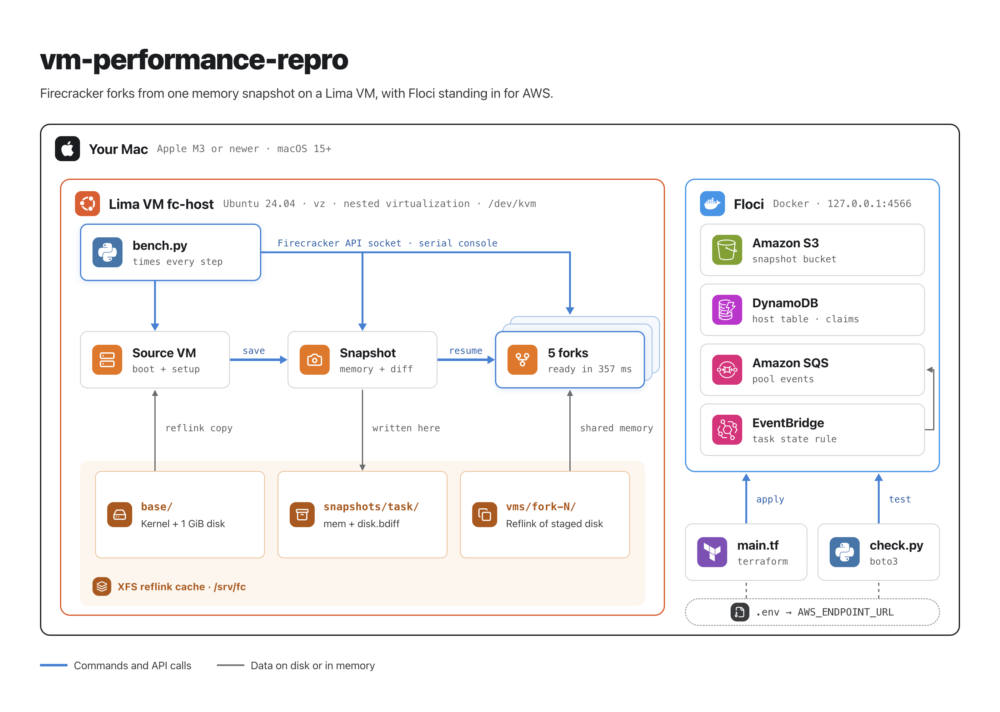

# vm-performance-repro

Measures how much faster a Firecracker microVM starts from a memory snapshot than from a cold boot, and how much memory and disk the forks of one snapshot share. Disks are copied with XFS reflinks, the method Cognition describes for Devin's VMs, and AWS is emulated locally with [Floci](https://github.com/floci-io/floci).



## What the benchmark does

1. **Cold path:** boots a VM from a reflink copy of a base disk, then runs a task setup that writes 50 MB to disk, fills 200 MB of guest RAM and waits 5 s.
2. **Snapshot:** pauses the set-up VM and saves its memory and CPU state.
3. **Disk checkpoint:** `blockdiff create` stores only the disk blocks that differ from the base disk. That `.bdiff` file is what a fleet would keep in S3.
4. **Stage:** `blockdiff apply` rebuilds the full disk from the base plus the diff, as a host would once per task. A SHA-256 check confirms it matches the source disk byte for byte.
5. **Forks:** resumes several VMs from the one snapshot, each on its own reflink copy of the staged disk with memory mapped copy-on-write. Each fork must answer a command and find the setup's marker file.

`bench.py` repeats this and reports the median and range across runs.

## Requirements

- An Apple silicon Mac with an M3 or newer chip on macOS 15 or later, for nested virtualization. A Linux host with `/dev/kvm` also works.
- [Lima](https://lima-vm.io), [Docker](https://www.docker.com), [uv](https://docs.astral.sh/uv/) and [Terraform](https://developer.hashicorp.com/terraform/install) 1.6 or later.
- The Lima config mounts `~/Documents/vm-performance-repro`. Clone the repo there, or change `location` in `lima/fc-host.yaml`.

## Run the benchmark

Run every command from the repo root.

1. Create and start the Linux VM that hosts Firecracker:

   ```bash
   limactl create --name=fc-host lima/fc-host.yaml && limactl start fc-host
   ```

2. Install Firecracker, `blockdiff`, the XFS reflink cache, and the base kernel and disk:

   ```bash
   limactl shell fc-host -- sudo ./host-setup.sh
   ```

3. Run the benchmark:

   ```bash
   limactl shell fc-host -- python3 bench.py --forks 5 --runs 3
   ```

4. Stop the VM when you're done:

   ```bash
   limactl stop fc-host
   ```

## Results

Firecracker v1.18.0 and `blockdiff` at commit `8d10a60`, on an M4 Mac with 16 GB of RAM, inside a Lima VM with nested virtualization, 4 vCPUs and 8 GiB. Guests have 1 vCPU and 512 MiB. Median and range across 3 runs of 5 forks. The staged disk matched the source disk byte for byte in 3 of 3 runs.

| Step | Median | Range |
|---|---|---|
| Reflink copy of the 1 GiB base disk | 1 ms | 1 ms – 3 ms |
| Cold boot to a root shell | 11.6 s | 11.0 s – 11.7 s |
| Task setup (50 MB to disk, 200 MB to RAM, wait 5 s) | 8.2 s | 8.2 s – 8.9 s |
| **Cold path total (boot + setup)** | **19.8 s** | 19.8 s – 19.9 s |
| Memory of the set-up VM (RSS) | 357 MiB | 356 MiB – 358 MiB |
| Pause + full snapshot (512 MiB guest) | 2.2 s | 2.0 s – 2.9 s |
| Disk checkpoint: `blockdiff create` | 7 ms | 6 ms – 8 ms |
| **Disk checkpoint size (the full disk is 1024 MiB)** | **51 MiB** | 51 MiB – 51 MiB |
| Stage on a host: `blockdiff apply` onto the base | 2 ms | 2 ms – 2 ms |
| Fork: reflink disk copy | 2 ms | 2 ms – 3 ms |
| Fork: snapshot load + resume | 4 ms | 3 ms – 4 ms |
| **Fork: resume to first command answered** | **357 ms** | 347 ms – 391 ms |
| Memory of 5 forks (RSS, total) | 280 MiB | 272 MiB – 289 MiB |
| **Memory of 5 forks (PSS, total)** | **67 MiB** | 66 MiB – 70 MiB |
| Extra cache disk used by 5 forks | 172 KiB | 140 KiB – 172 KiB |

- **Start time:** a fork answers in 357 ms against 19.8 s for boot plus setup, about 55× faster, and it skips the setup entirely.
- **Memory:** five forks hold 67 MiB of their own memory in total (PSS), against 357 MiB for one cold VM after setup. Forks share snapshot pages until they write to them.
- **Disk checkpoint:** the diff is 51 MiB against a 1024 MiB disk, about 5% of it, because only the setup's 50 MB of writes changed. That's what a host would download from S3 per task.
- **Disk speed:** `create` and `apply` take milliseconds because, on the same XFS filesystem, they clone blocks instead of copying them. On a real host, the cost of staging is downloading the diff.
- **Caveat:** these numbers come from nested virtualization on a Mac. They show the method works, not how fast an EC2 host would be. Cold boot also varies between sessions on the Mac: an earlier run measured 9.3 s.

## Local AWS with Floci

The control-plane pieces (S3, DynamoDB, SQS, EventBridge) are a Terraform stack in `aws/`, applied to Floci, a free AWS emulator. The provider block has nothing Floci-specific: `.env` points the AWS SDKs and Terraform at Floci and explains each macOS workaround. Without `.env`, the same stack applies to real AWS.

1. Start Floci:

   ```bash
   docker run -d --name floci -p 127.0.0.1:4566:4566 floci/floci:2.5.0
   ```

2. Load the settings and apply the stack:

   ```bash
   set -a && . ./.env && set +a && terraform -chdir=aws init && terraform -chdir=aws apply -auto-approve
   ```

3. Run the checks:

   ```bash
   uv run python aws/check.py
   ```

4. Remove the stack:

   ```bash
   terraform -chdir=aws destroy -auto-approve
   ```

| Check | Result |
|---|---|
| S3: upload and download 8 MiB | Passes, about 170 ms |
| DynamoDB: two conditional READY → CLAIMED writes on one item | Passes: the first wins, the second gets `ConditionalCheckFailedException` |
| EventBridge rule into SQS | Passes: RUNNING and STOPPED arrive, PENDING is filtered out |

## Layout

| Path | Purpose |
|---|---|
| `bench.py` | Runs the cold path, snapshot, disk checkpoint, stage and forks, then prints the results table |
| `host-setup.sh` | Prepares a Firecracker host and builds `blockdiff`. Set `FC_DEVICE` to use a real disk, such as EC2 NVMe, instead of a loop file. |
| `lima/fc-host.yaml` | Ubuntu 24.04 VM with nested virtualization |
| `aws/main.tf` | Terraform stack: S3 bucket, DynamoDB table, SQS queue and an EventBridge rule into the queue |
| `aws/check.py` | boto3 checks against the stack's Terraform outputs |
| `.env` | Floci settings and workarounds |
| `docs/architecture.png` | The diagram above, drawn in Paper |

## Known limitations

- Firecracker 1.18.0 can't point a restored drive at a new file during snapshot load. `bench.py` loads the snapshot paused, repoints the drive with `PATCH /drives`, then resumes.
- [`CognitionAI/blockdiff`](https://github.com/CognitionAI/blockdiff) has no license file, so this repo doesn't include its code. `host-setup.sh` builds it from GitHub at a pinned commit. Using it beyond this experiment needs Cognition's permission or a rewrite.
- `blockdiff` covers disks only. The 512 MiB memory file stays a full snapshot, because Firecracker's incremental memory snapshots are still in developer preview.
- Snapshots taken on Arm don't predict Intel hosts, and a snapshot resumes only on the CPU model that made it.
- `terraform init` downloads the AWS provider, about 730 MB unpacked, into `aws/.terraform/`.
